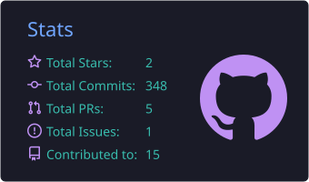
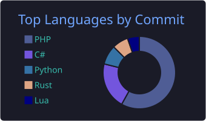
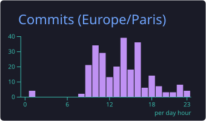

<h1 align="center">Salut, je suis Lucas</h1>

  

  
  

---

## ‍ À propos de moi

-  Je travaille actuellement sur diferent projet perso privé dont des jeux, de l'aprentissage de language ou juste des logiciel
-  Je vais commencé l'apprentissage  en ce moment du C,C++ : 
-  Ouvert a la discution_

---

## ️ Stack & technologies

### Web front

### Back-end & bases de données

### Systèmes & autres langages

### Jeu vidéo

### Outils

---

##  Statistiques GitHub

  
  

  

---

##  Me contacter

  
  
  

  

